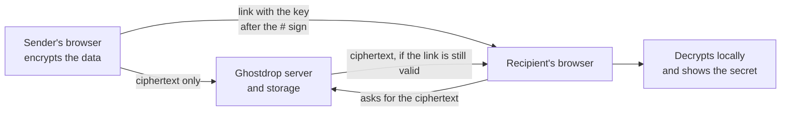

<div align="center">

<!--
  LOGO SLOT
  Save your logo as docs/assets/logo.png (or logo.svg) and keep the path below.
  Recommended: square, 400x400 or larger, transparent background.
-->


# Ghostdrop

**Share it once. Then it's gone.**

End-to-end encrypted secret and file sharing with self-destructing links.
The server only ever sees ciphertext.

<!-- Replace YOUR_USERNAME, then delete any badge you don't use. -->
[](https://github.com/YOUR_USERNAME/ghostdrop/actions)
[](./LICENSE)


[Live demo](https://YOUR-DEMO-URL) | [Architecture](./docs/architecture.md) | [Format spec](./docs/FORMAT.md)

</div>

<!--
  HERO IMAGE / DEMO GIF SLOT
  Save a screenshot or a short screen recording as docs/assets/demo.gif (or hero.png).
  A 10-second GIF of "create a secret, open the link, see it expire" works best.
-->
<p align="center">
  
</p>

---

## Table of contents

- [Why Ghostdrop](#why-ghostdrop)
- [Features](#features)
- [How it works](#how-it-works)
- [What the server can and can't see](#what-the-server-can-and-cant-see)
- [Screenshots](#screenshots)
- [Tech stack](#tech-stack)
- [Getting started](#getting-started)
- [Configuration](#configuration)
- [Project structure](#project-structure)
- [Testing](#testing)
- [Roadmap](#roadmap)
- [Security](#security)
- [Documentation](#documentation)
- [Contributing](#contributing)
- [License](#license)
- [Acknowledgements](#acknowledgements)

---

## Why Ghostdrop

Developers paste API keys, passwords, and `.env` files into chat apps every day. Those messages sit in history, backups, and search indexes forever.

Ghostdrop gives you a safer way: encrypt in your browser, share a link, and let it expire after a set time or a set number of views. No account is needed, and the server cannot read what you share.

## Features

- **End-to-end encryption.** Everything is encrypted in the browser with AES-256-GCM before upload.
- **Zero-knowledge server.** The key lives in the URL fragment (after the `#`), which browsers never send to servers.
- **Text secrets and files.** Share a password or a whole file, encrypted in 2 MiB chunks so large files don't need to fit in memory.
- **Self-destructing links.** Expire by time (1 hour, 1 day, 7 days) and by number of views (burn after reading).
- **Optional password.** A second factor derived with Argon2id and combined with the link key.
- **Encrypted filenames.** Filename, type, and size are hidden inside the encrypted payload.
- **Preview-bot safe.** Link previews from Slack or WhatsApp can't use up a one-time link, because the secret loads only after you click **Reveal**.
- **Revoke any time.** The creator gets an owner token to delete a drop early.
- **Fail closed.** Any tampering, truncation, or wrong key shows a generic error and no partial data.
- **Open format.** A written, versioned spec with test vectors, so independent clients (like a CLI) stay compatible.

## How it works



1. The sender's browser generates a random 256-bit key and encrypts the text or file.
2. Only the ciphertext is uploaded. The key goes into the link fragment and never reaches the server.
3. The recipient opens the link and clicks **Reveal**. The server hands over the ciphertext and counts one view.
4. The recipient's browser decrypts locally and verifies the entire stream before showing anything.
5. When the time or view limit is reached, the server deletes the data.

The full flow, with sequence diagrams for every step, is in [docs/architecture.md](./docs/architecture.md).

## What the server can and can't see

| | Server |
|---|---|
| Plaintext, filename, file type | Never |
| The link key (after `#`) | Never |
| Your password | Never |
| Encrypted records and their sizes | Yes |
| Expiry, view limit, whether a password is set | Yes |
| IP address and timing | Yes, if logged |

## Screenshots

<!--
  SCREENSHOT SLOTS
  Add images to docs/assets/ with these names, or change the paths.
-->

| Create a drop | Reveal a drop |
|:---:|:---:|
|  |  |

| Share link | Expired link |
|:---:|:---:|
|  |  |

## Tech stack

| Layer | Technology |
|---|---|
| Backend | Python 3.12, FastAPI, Uvicorn |
| Database | PostgreSQL, SQLAlchemy 2.0, Alembic |
| Blob storage | S3-compatible (MinIO locally, Cloudflare R2 in production) |
| Frontend | Next.js, TypeScript, Tailwind CSS |
| Cryptography | WebCrypto (AES-256-GCM, HKDF-SHA-256), Argon2id (WASM), canonical CBOR |
| Background jobs | APScheduler |
| Testing | pytest, Vitest, Playwright |

## Getting started

### Prerequisites

- Docker and Docker Compose
- Python 3.12 and [uv](https://docs.astral.sh/uv/)
- Node.js 20+

### Run locally

```bash
# 1. Clone
git clone https://github.com/YOUR_USERNAME/ghostdrop.git
cd ghostdrop

# 2. Start PostgreSQL and MinIO
docker compose up -d

# 3. Backend
cd backend
cp .env.example .env
uv sync
uv run alembic upgrade head
uv run uvicorn app.main:app --reload
# API on http://localhost:8000

# 4. Frontend (new terminal)
cd web
cp .env.example .env.local
npm install
npm run dev
# App on http://localhost:3000
```

<!-- Adjust these commands if your final scripts or ports differ. -->

Open http://localhost:3000, create a drop, and open the link in a private window to see the one-time behavior.

## Configuration

Backend settings come from environment variables (see `backend/.env.example`):

| Variable | Purpose |
|---|---|
| `DATABASE_URL` | PostgreSQL connection string |
| `S3_ENDPOINT_URL` | Object storage endpoint (MinIO or R2) |
| `S3_BUCKET` | Bucket for encrypted records |
| `S3_ACCESS_KEY_ID` / `S3_SECRET_ACCESS_KEY` | Storage credentials |
| `ALLOWED_ORIGIN` | Frontend origin allowed by CORS |
| `MAX_FILE_BYTES` | Maximum upload size (default 50 MiB) |
| `PRESIGNED_URL_TTL_SECONDS` | Lifetime of download URLs (default 300) |

Never commit real credentials. Keep `.env` files out of version control.

## Project structure

```text
ghostdrop/
  docs/
    architecture.md      # components, flows, diagrams
    FORMAT.md            # byte-level encryption format (v1)
    vectors/             # language-neutral test vectors
    assets/              # logo, screenshots, demo GIF
  backend/               # FastAPI app, models, migrations, tests
  web/                   # Next.js app and the crypto module
  cli/                   # Python CLI (planned)
  docker-compose.yml
```

## Testing

```bash
# Backend
cd backend && uv run pytest

# Frontend unit tests
cd web && npm test

# End-to-end
cd web && npx playwright test
```

The test suite includes shared **test vectors** that the browser and Python implementations must both reproduce byte for byte, negative tests (flipped bits, reordered or truncated records, wrong password), and a concurrency test proving that 50 simultaneous opens of a one-view link produce exactly one success.

## Roadmap

**MVP**
- [ ] Text secrets with time and view limits
- [ ] File sharing with chunked encryption
- [ ] Optional password protection
- [ ] Delete link for the creator
- [ ] Cleanup job for expired data
- [ ] Rate limiting and security headers
- [ ] Published format spec with test vectors

**Next**
- [ ] Python CLI (`ghostdrop send`, `ghostdrop get`)
- [ ] Copy button, QR code, dark mode polish
- [ ] Self-hosting guide

**Later**
- [ ] Open notifications by email or webhook
- [ ] Optional accounts with drop history
- [ ] Team workspaces and custom expiry policies

## Security

Ghostdrop is designed so the server never learns keys or plaintext, but the design has honest limits:

- **The server serves the JavaScript.** A compromised server could ship malicious code that steals the key or password. Open source, a documented format, and an independent CLI reduce this risk but don't remove it.
- **Links are bearer tokens.** Anyone with the full link (and password, if set) can decrypt. There is no recovery if the key or password is lost.
- **Expiry is not cryptographic erasure.** A recipient can save the data before it expires.
- **A view is a retrieval,** not a confirmed decryption. A wrong password can still use up a view.
- **Metadata leaks.** Sizes, timing, and logs can reveal approximate file sizes and usage.

This project has **not been independently audited.** Don't use it for high-value secrets until it has been reviewed by a cryptography specialist.

**Reporting a vulnerability:** please don't open a public issue. Email `security@YOUR-DOMAIN` (or use GitHub's private vulnerability reporting) with the details.

## Documentation

- [Architecture and flows](./docs/architecture.md)
- [Encryption format specification](./docs/FORMAT.md)

## Contributing

Contributions are welcome. Please open an issue to discuss larger changes first. Any change to the encryption format needs a new format version and new test vectors, so please read [FORMAT.md](./docs/FORMAT.md) before touching the crypto code.

1. Fork the repo and create a branch
2. Make your change with tests
3. Run the full test suite
4. Open a pull request

## License

<!-- Choose a license and add a LICENSE file. MIT is a common choice for projects like this. -->
Released under the [MIT License](./LICENSE).

## Acknowledgements

- [NIST SP 800-38D](https://csrc.nist.gov/pubs/sp/800/38/d/final) (AES-GCM), [RFC 5869](https://www.rfc-editor.org/rfc/rfc5869) (HKDF), [RFC 9106](https://www.rfc-editor.org/rfc/rfc9106) (Argon2), [RFC 8949](https://www.rfc-editor.org/rfc/rfc8949) (CBOR)
- [Google Tink](https://developers.google.com/tink/streaming-aead/aes_gcm_hkdf_streaming) for the segmented-nonce idea (Ghostdrop's format is its own and is not Tink-compatible)

---

<div align="center">

Built by [YOUR NAME](https://github.com/amarjit03)

</div>
