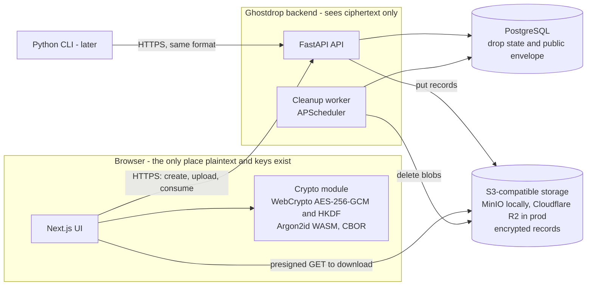
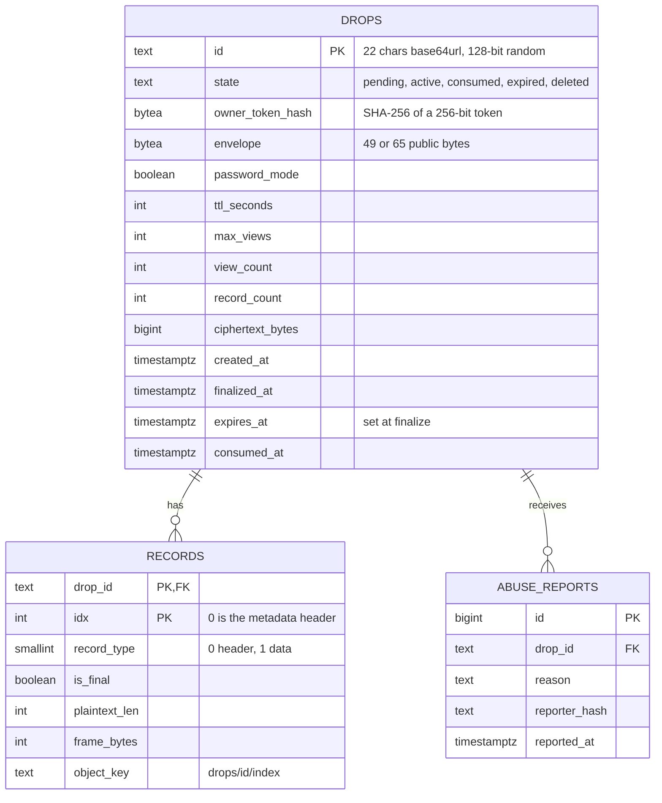
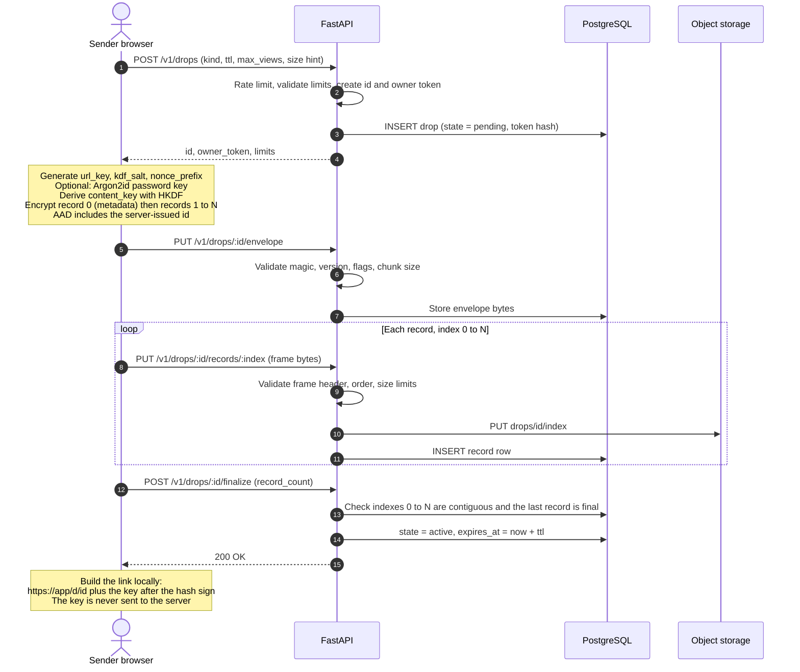
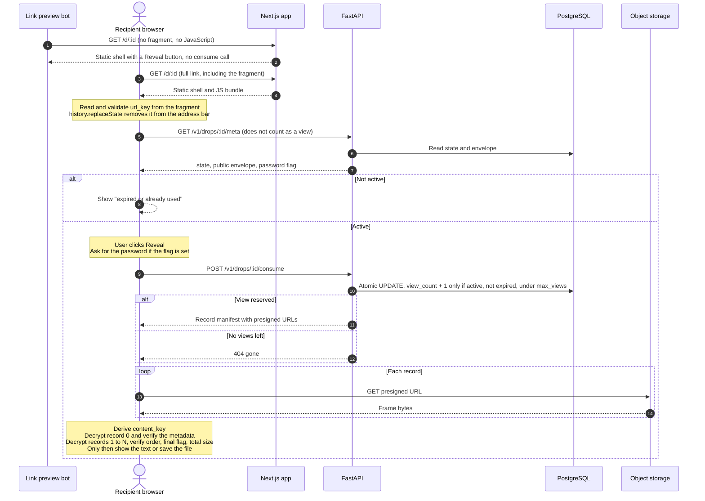
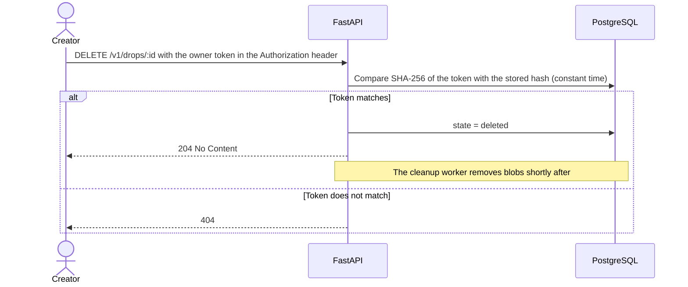
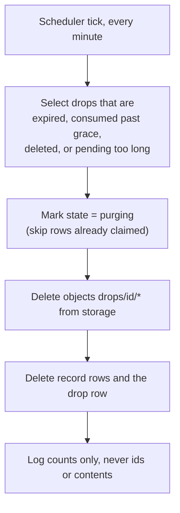
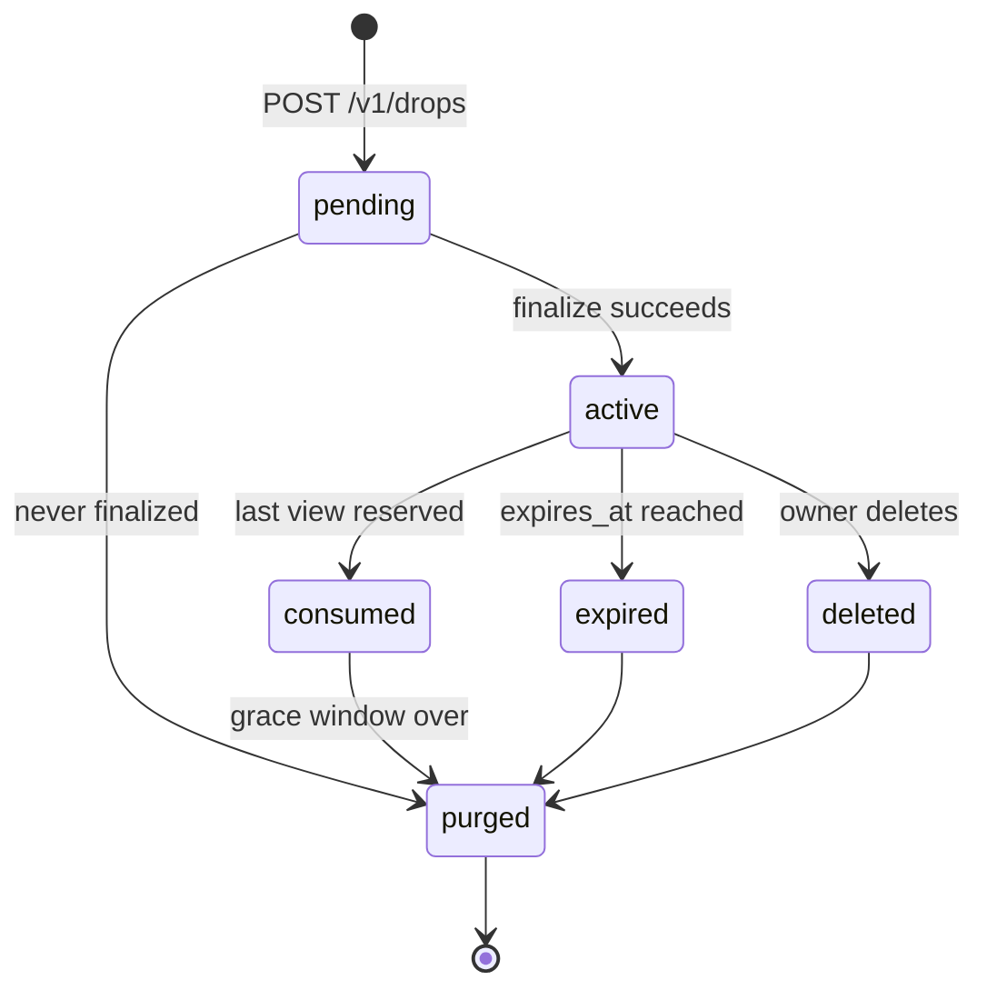
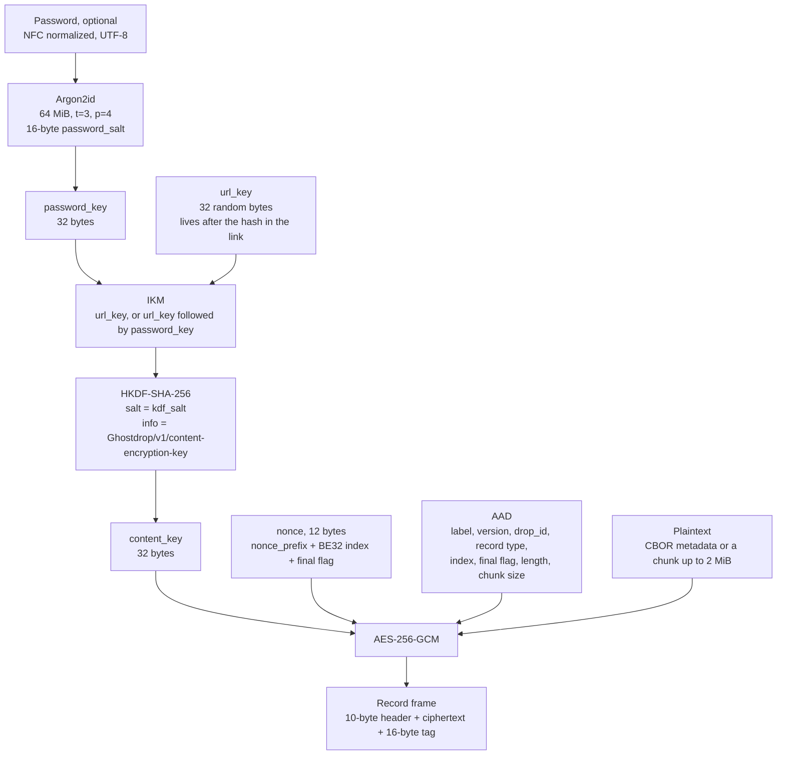
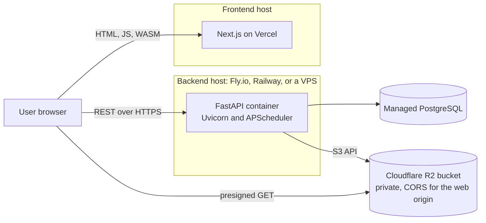

# Ghostdrop Architecture

**Status:** Draft for implementation
**Backend:** Python (FastAPI) | **Frontend:** Next.js + TypeScript | **Format:** see [FORMAT.md](./FORMAT.md) (version `0x01`)

This document explains how the whole application fits together: the components, the data model, the API, and every flow from creating a drop to deleting it. The byte-level encryption format lives in `FORMAT.md`. This file only repeats the parts needed to understand the flow, so if the two ever disagree, `FORMAT.md` wins.

All diagrams are [Mermaid](https://mermaid.js.org/) and render on GitHub.

---

## 1. Overview and principles

Ghostdrop lets someone share a text secret or a file through a link that expires by time or by number of views. The server never sees plaintext or keys.

1. **The browser does all cryptography.** Encryption and decryption happen in the browser. The backend stores ciphertext only.
2. **The key travels in the URL fragment.** The link looks like `https://app/d/{id}#{key}`. Browsers never send the fragment in an HTTP request.
3. **The server enforces access, not secrecy.** Expiry and view limits are server policy. They are not cryptographic erasure.
4. **Fail closed.** Any authentication failure, missing record, or inconsistency shows a generic error and no partial plaintext.
5. **Boring technology.** FastAPI, PostgreSQL, S3-compatible storage, standard primitives (AES-256-GCM, HKDF-SHA-256, Argon2id).
6. **No accounts in the MVP.** Whoever holds the complete link (and password, if set) can open the drop. The creator holds a separate owner token to revoke it.

---

## 2. System components



| Component | Responsibility |
|---|---|
| **Next.js UI** | Create page, reveal page, expired page. Reads the key from the fragment and removes it from the address bar. |
| **Crypto module** (`web/src/lib/crypto`) | Key generation, Argon2id, HKDF, nonce and AAD construction, record encryption and decryption, CBOR metadata, strict validation. |
| **FastAPI API** | Rate limiting, input validation, drop lifecycle, atomic view counting, presigned URLs. Never decrypts anything. |
| **PostgreSQL** | Drop state, public envelope, record index, owner token hash, abuse reports. |
| **Object storage** | One object per encrypted record. Private bucket. |
| **Cleanup worker** | Removes expired, consumed, deleted, and abandoned drops and their blobs. |
| **Python CLI (later)** | Same format, same API. Proves the spec is language-neutral. |

---

## 3. What each party can see

| Data | Sender browser | Recipient browser | Backend and DB | Object storage |
|---|:---:|:---:|:---:|:---:|
| URL key | yes | yes | **never** | **never** |
| Password and derived password key | yes | yes | **never** | **never** |
| Plaintext, filename, MIME type | yes | yes | **never** | **never** |
| Public envelope (salts, nonce prefix, password flag) | yes | yes | yes | no |
| Encrypted records and their lengths | yes | yes | yes | yes |
| Owner token | yes | no | hash only | no |
| IP address, timing, request volume | n/a | n/a | yes, if logged | provider logs |

The server can infer the approximate or exact plaintext size from record lengths. It can also see whether a password is set. See `FORMAT.md` sections 9 and 14.

---

## 4. Data model



Notes:

- **Drop id:** `secrets.token_urlsafe(16)` gives 22 characters from `[A-Za-z0-9_-]`, which matches the charset the format requires. The id is part of every record's AAD.
- **Object keys:** `drops/{id}/{index:07d}`. Seven digits cover the format maximum of 2^20 records.
- **`expires_at` starts at finalize**, not at creation, so slow uploads don't eat into the lifetime.
- **Indexes:** `drops(state, expires_at)` for the cleanup query, and the `(drop_id, idx)` primary key on `records`.

---

## 5. API surface

Base path `/v1`. All bodies are binary or JSON as noted. Drop ids are validated against `^[A-Za-z0-9_-]{1,128}$` before any lookup.

| Method | Path | Auth | Purpose |
|---|---|---|---|
| `POST` | `/drops` | none (rate limited) | Reserve a drop. Body: `kind`, `ttl_seconds`, `max_views`, size hint. Returns `id`, `owner_token`, limits. |
| `PUT` | `/drops/:id/envelope` | owner token | Store the public envelope. Server validates magic, version, flags, chunk size. |
| `PUT` | `/drops/:id/records/:index` | owner token | Upload one record frame. Retrying with identical bytes is fine. Different bytes for the same index return `409`. |
| `POST` | `/drops/:id/finalize` | owner token | Check the sequence, activate the drop, start the expiry clock. |
| `GET` | `/drops/:id/meta` | none | State, envelope, password flag. **Never counts as a view.** |
| `POST` | `/drops/:id/consume` | none | Atomically reserve a view. Returns the record manifest with short-lived presigned URLs. |
| `DELETE` | `/drops/:id` | owner token | Revoke now. |
| `POST` | `/drops/:id/report` | none (rate limited) | Abuse report. |
| `GET` | `/health` | none | Liveness. |

**Response conventions**

- Unknown, expired, consumed, and deleted drops all return the same `404` body, so the API doesn't reveal which one it was. The UI shows "This link has expired or already been used."
- `413` too large, `422` malformed frame or envelope, `409` conflicting record, `429` rate limited.
- Decryption errors never reach the server. They are shown locally and generically.

**MVP limits (policy, not format limits):** files up to 50 MiB (about 26 data records plus the header), text up to 2 MiB, TTL choices of 1 hour, 1 day, or 7 days, `max_views` from 1 to 100.

---

## 6. Application flows

### 6.1 Create a drop

The format puts the server-issued drop id into every record's AAD, so the client must **reserve the id first** and encrypt afterwards.



Details that matter:

- The server can validate **structure** (frame header, index order, final flag, lengths) because those fields are public. It cannot verify GCM tags, since it has no key.
- If an upload is interrupted, **resend the exact same frame bytes.** Never re-encrypt the same record with the same key (`FORMAT.md` section 7.2). To change content, start a new drop with fresh keys and salts.
- A drop that never reaches `finalize` stays `pending` and is purged after about an hour.
- Files are encrypted and uploaded **one record at a time**, so memory use stays near one chunk (2 MiB).

### 6.2 Open a drop



Why this shape:

- **Link preview bots** (Slack, WhatsApp, and similar) fetch the page but never click. Because `consume` only happens after an explicit **Reveal** click, a bot cannot burn a one-time link.
- **`meta` is separate from `consume`.** The page can show the password prompt or the "gone" state without costing a view.
- **Key handling comes first.** The fragment is read and stripped before any other script or resource runs on the page.
- **No partial plaintext.** For large files, write to a temporary destination and finalize it only after every record and the total size have been verified.

#### Atomic view reservation

Two people opening a one-time link at the same moment must produce exactly one success. The whole check and increment is a single SQL statement:

```sql
UPDATE drops
SET view_count  = view_count + 1,
    state       = CASE WHEN view_count + 1 >= max_views THEN 'consumed' ELSE state END,
    consumed_at = CASE WHEN view_count + 1 >= max_views THEN now() ELSE consumed_at END
WHERE id = :id
  AND state = 'active'
  AND expires_at > now()
  AND view_count < max_views
RETURNING envelope, record_count;
```

- Zero rows returned means no view was reserved, so respond with the generic `404`.
- When the last view is reserved, the drop becomes `consumed`. Its blobs stay for a short **grace window** (about 10 minutes, longer than the 5-minute presigned URL lifetime) so the reserved download can finish. The cleanup worker deletes them afterwards.
- A **view means a retrieval authorization**, not a successful decryption (`FORMAT.md` section 9.3). A wrong password can still use up a view, and the UI should say so.

### 6.3 Revoke (delete now)



The creator's confirmation screen keeps the owner token in memory and offers a **Delete now** button. An optional revoke link can carry the token in its own URL fragment.

### 6.4 Cleanup worker



- Every step is **idempotent**, so a crash halfway is safe to retry on the next tick.
- If you run more than one API instance, make only one worker run the job, for example with a PostgreSQL advisory lock (`pg_try_advisory_lock`).
- After a drop is purged, its id is simply unknown and returns the same generic `404`.

### 6.5 Drop lifecycle



Only an `active` drop can be consumed. `consumed`, `expired`, and `deleted` are all treated as "gone" by the public API.

---

## 7. Encryption flow and wire layout

### 7.1 Key and record pipeline



Both factors are required in password mode: the URL key alone or the password alone cannot derive the content key.

### 7.2 What gets stored for one drop

```text
Envelope (public, 49 bytes, or 65 with the password salt)
 |
 +-- Record 0   type 0x00  encrypted CBOR metadata       final = 0
 +-- Record 1   type 0x01  data, 2 MiB                   final = 0
 +-- Record 2   type 0x01  data, 2 MiB                   final = 0
 +-- Record 3   type 0x01  data, 1 MiB (last chunk)      final = 1
```

(Example: a 5 MiB file. A zero-byte file has only record 0, marked final. A text secret has record 0 plus exactly one data record.)

**Envelope**

| Offset | Length | Field |
|---:|---:|---|
| 0 | 4 | Magic `GSDP` |
| 4 | 1 | Version `0x01` |
| 5 | 1 | Flags (bit 0 = password mode) |
| 6 | 4 | Chunk size, BE32, must be `2097152` |
| 10 | 7 | Nonce prefix |
| 17 | 32 | KDF salt |
| 49 | 16 | Password salt, only if flag bit 0 is set |

**Record frame**

| Offset | Length | Field |
|---:|---:|---|
| 0 | 4 | Record index, BE32 |
| 4 | 1 | Record type (`0x00` header, `0x01` data) |
| 5 | 1 | Flags (bit 0 = final) |
| 6 | 4 | Plaintext length, BE32 |
| 10 | length + 16 | Ciphertext followed by the 16-byte GCM tag |

The frame header is not encrypted, but its values are bound into the AAD, so tampering with them breaks authentication.

---

## 8. Security controls

| Area | Control |
|---|---|
| **Transport** | HTTPS only, HSTS. |
| **Decrypt page** | No third-party scripts, fonts, analytics, or images. `Referrer-Policy: no-referrer`, `X-Content-Type-Options: nosniff`, `frame-ancestors 'none'`. |
| **CSP (starting point)** | `default-src 'none'; script-src 'self' 'wasm-unsafe-eval'; style-src 'self'; connect-src 'self' <api-origin> <bucket-origin>; img-src 'self' data:; base-uri 'none'; form-action 'self'; frame-ancestors 'none'`. Argon2id WASM needs `'wasm-unsafe-eval'`. Use nonces for Next.js inline scripts instead of `unsafe-inline`. |
| **API responses** | `Cache-Control: no-store`. CORS limited to the web origin. |
| **Input validation** | Id regex, envelope and frame validation, record-count and size caps, enforced **before** expensive work. |
| **KDF parameters** | Fixed in the client code. Never read from server data. |
| **Tokens** | Owner token is 256-bit random, stored only as a SHA-256 hash, compared in constant time. |
| **Rate limits** | Per IP on create, upload, consume, meta, and report (`slowapi`, or Redis once you run several instances). |
| **Logging** | Never log request bodies, tokens, or keys. Truncate or hash drop ids. There should be nothing secret in URLs since the key stays in the fragment. |
| **Storage** | Private bucket, no public listing, presigned GET URLs valid for about 5 minutes, CORS allowing only the web origin. |
| **Abuse** | Report endpoint, per-IP quotas, manual takedown by drop id. Content cannot be scanned because it is end-to-end encrypted. Say so in the terms. |
| **Dependencies** | Pin versions. Audit the Argon2id WASM and CBOR libraries. Review any crypto-related update. |

---

## 9. Deployment



**Local development:** `docker compose up` runs PostgreSQL, MinIO, the API, and the web app. Point the S3 settings at MinIO and everything works offline.

**Configuration** comes from environment variables: database URL, S3 endpoint and credentials, allowed web origin, limits (file size, TTLs, max views), rate-limit settings. Never commit secrets.

---

## 10. Repository layout

```text
ghostdrop/
  docs/
    architecture.md
    FORMAT.md
    vectors/               # language-neutral test vectors (JSON)
  backend/
    pyproject.toml
    app/
      main.py              # FastAPI app and middleware
      api/                 # routers: drops, records, consume, report, health
      core/                # settings, security headers, rate limiting
      db/                  # SQLAlchemy models, Alembic migrations
      services/            # drops, records validation, storage, tokens
      workers/             # cleanup job
    tests/
  web/
    src/
      app/                 # create page, d/[id] reveal page
      lib/crypto/          # key, nonce, aad, records, password, cbor
      lib/api.ts           # typed API client
    tests/                 # Vitest unit tests, Playwright E2E
  cli/                     # Python CLI (later)
  docker-compose.yml
```

---

## 11. Testing strategy

| Layer | What to test | Tools |
|---|---|---|
| **Crypto vectors** | Browser and Python reproduce every vector in `docs/vectors/` byte for byte, including the fixed vector in `FORMAT.md` section 12.2. | Vitest, pytest |
| **Negative crypto** | Flipped bit, wrong key, wrong password, wrong drop id, reordered, duplicated, missing, or truncated records, bad final flag (`FORMAT.md` section 12.3). Nothing partial is ever returned. | Vitest, pytest |
| **API integration** | Create, upload, finalize, consume, delete, expiry. Frame validation and limits. | pytest, httpx, real PostgreSQL and MinIO |
| **Concurrency** | 50 parallel `consume` calls on a `max_views = 1` drop give exactly one success. | pytest with `asyncio.gather` |
| **Cleanup** | Expired, consumed, deleted, and pending drops disappear with their blobs. A crash mid-run is recoverable. | pytest |
| **End to end** | Create in one browser context, open in another, verify one-time behavior, expiry, and the password flow. A preview-bot style GET must not burn the link. | Playwright |
| **Security** | Headers present, no keys or fragments in logs, rate limits enforced. | pytest, manual checks |

---

## 12. Open decisions

1. **Unlock record 0 before consuming?** Releasing the small metadata record without counting a view would let the client check the password before a view is spent, so a typo wouldn't burn a one-time link. This conflicts with `FORMAT.md` section 9.3 as written, so decide and amend the spec if you want it.
2. **Presigned downloads or proxy through the API?** Presigned URLs offload bandwidth. Proxying gives a single choke point for rate limits and logging, and is simpler to build first.
3. **Grace window length** for consumed drops (suggested 10 minutes, longer than the presigned URL lifetime).
4. **Rate limiter backend:** in-memory is fine for one instance. Use Redis when you scale out.
5. **Argon2id WASM library:** pick one, and check its parameter semantics against the Argon2 vectors in RFC 9106 before relying on it.
6. **Revoke link:** keep the owner token in memory only, or also offer a revoke link.

---

## 13. Known limitations

These come from the format and the browser trust model. State them plainly in your README and UI.

- **The server serves the JavaScript.** A malicious or compromised server could ship code that steals the fragment or password. The CLI and open-source code reduce this risk but don't remove it.
- **Metadata leaks.** Record lengths, timing, view counts, and logs reveal approximate sizes and behavior.
- **Views are retrievals.** A wrong password or dropped connection can still consume a view.
- **Bearer links.** Anyone with the full link (and password) can decrypt. There is no sender identity and no recovery if the key or password is lost.
- **No cryptographic erasure.** Expiry stops the server from serving the data. It cannot stop a recipient who already saved it.

Have an independent cryptography reviewer check `FORMAT.md` and the client implementation before anyone trusts this with high-value secrets.