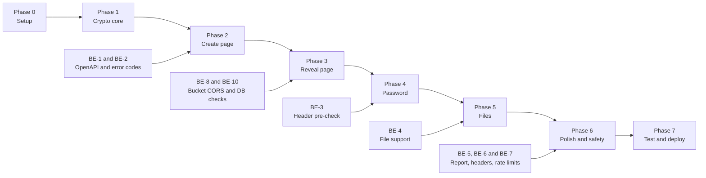
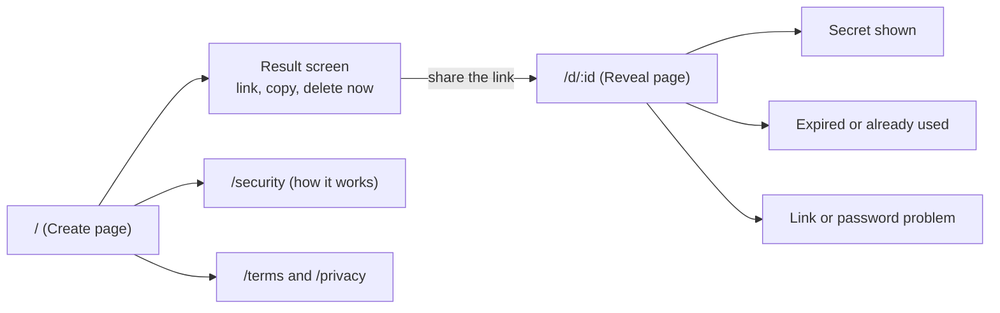
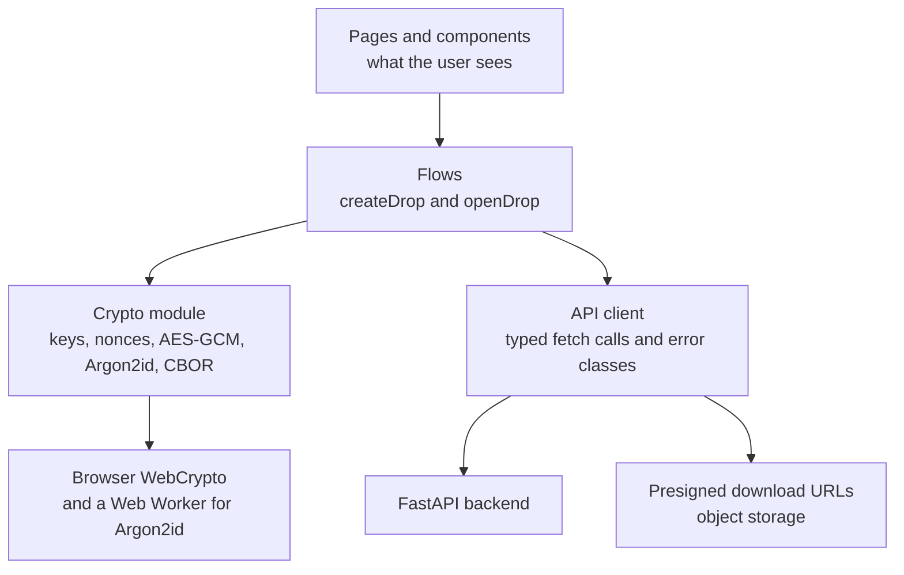
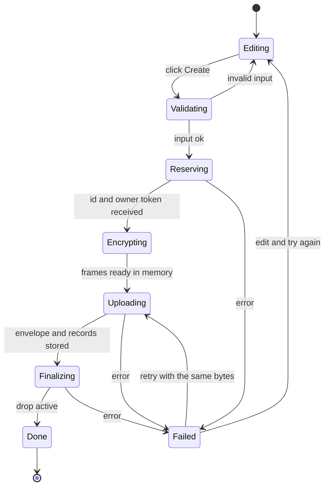
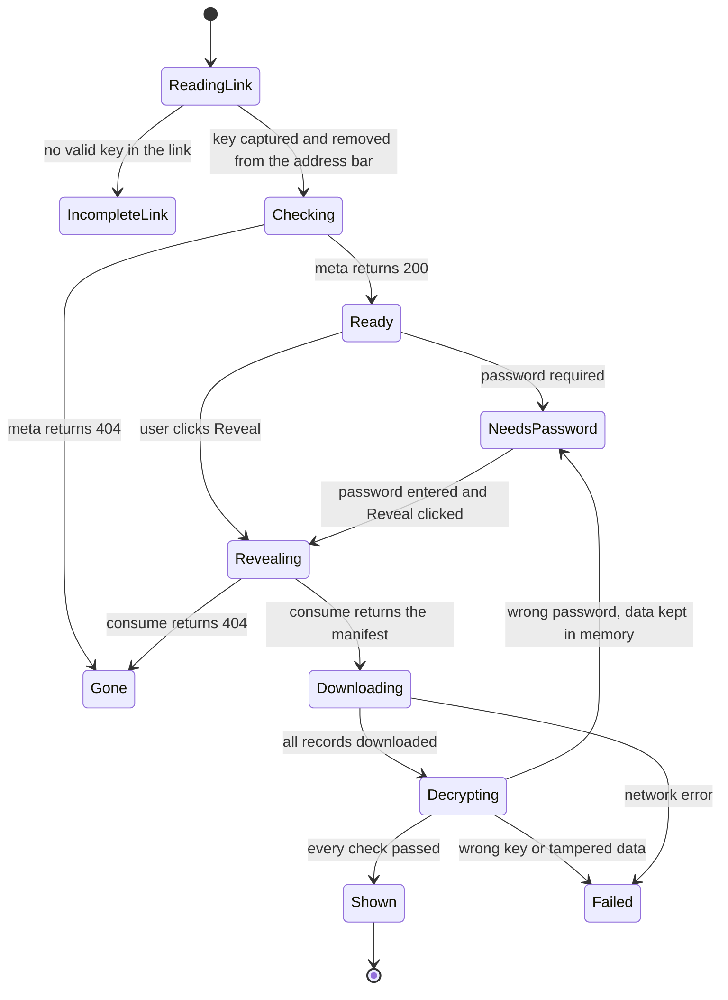

# GhostDrop Frontend Plan (MVP)

**Status:** Draft for implementation
**Frontend:** Next.js + TypeScript + Tailwind | **Backend:** FastAPI (see [architecture.md](./architecture.md) and [FORMAT.md](./FORMAT.md))
**Written for:** a developer who is new to frontend work. Every concept is explained the first time it appears.

---

## 0. Read this first

### What this document is
A step-by-step plan for building the GhostDrop web app, based on what the backend can do **today**. It covers what to build, in which order, how each screen should behave, how the encryption fits in, and what the backend still needs. Section 3 is the **backend gap report**: the changes and new endpoints the frontend needs.

### The short version
1. **Build order:** encryption code first (no screens), then the Create page, then the Reveal page, then password, then files, then polish, then deploy.
2. **First demo (text only)** is possible after Phase 3. That is roughly 2 to 3 weeks of part-time work.
3. **The backend is mostly ready.** It already supports the full text-drop flow. It needs 2 new endpoints, 1 larger change (file support), and some contract and configuration fixes. See [section 3.3](#33-backend-change-report).
4. **The hardest and most important part is the crypto module** (Phase 1). It has no UI, it is fully testable, and everything else depends on it. Do not rush it.

### How to use this plan with AI
You can turn any phase in section 11 into a prompt like the earlier backend prompts: context, exact rules, steps with code, tests, and a "done when" check. Tell me which phase you want first.

---

## 1. MVP scope

| Priority | Feature | Notes |
|---|---|---|
| **Must** | Create a text secret with expiry (1 hour, 1 day, 7 days) and view limit (1 to 100) | Encrypted in the browser |
| **Must** | Share link with a **Copy** button | Key is in the part after `#` |
| **Must** | Reveal page with an explicit **Reveal** click | Protects against link-preview bots |
| **Must** | Clear "expired or already used" state | One generic message for every gone case |
| **Must** | **Delete now** for the creator | Uses the owner token kept in memory |
| **Must** | Friendly error handling and loading states | Network errors, rate limits, tampering |
| **Must** | About / Security page explaining the model honestly | Builds trust |
| **Should** | Optional password protection | Needs Argon2id in the browser |
| **Should** | File sharing (up to 50 MiB) | Needs backend changes (BE-4) |
| **Should** | Report abuse link | Needs a new endpoint (BE-5) |
| **Should** | Mobile-friendly layout and dark mode | Tailwind makes this easy |
| **Later** | QR code, revoke link page, open-notifications, accounts, CLI, translations | Not in the MVP |

**Suggested releases:** v0.1 = text + password. v0.2 = files. Ship v0.1 first, because it already proves the whole design.

---

## 2. Concepts you will meet (plain-language glossary)

| Term | Meaning |
|---|---|
| **Component** | A reusable piece of the screen (a button, a form) written as a function that returns markup. |
| **State** | Data a component remembers, such as the text typed so far. When state changes, the screen updates. |
| **Effect** | Code that runs after the screen draws, for example reading the URL. |
| **Route / page** | A URL that shows a screen. In Next.js, the folder name under `app/` becomes the URL. |
| **Client component** | A component that runs in the browser. Anything touching `window`, the URL fragment, or WebCrypto must be one. |
| **API client** | A small module that wraps `fetch` calls to the backend so the rest of the app doesn't repeat them. |
| **Environment variable** | A setting outside the code, such as the backend URL. Names starting with `NEXT_PUBLIC_` are visible in the browser. |
| **async / await / Promise** | The way JavaScript waits for slow work (network, encryption) without freezing. |
| **Uint8Array / ArrayBuffer** | Raw bytes. All encryption works on bytes, not strings. |
| **WebCrypto** | The browser's built-in cryptography (`crypto.subtle`). It gives us AES-GCM and HKDF. |
| **Web Worker** | A background thread. We run the slow Argon2id password hashing there so the page doesn't freeze. |
| **Secure context** | A page served over HTTPS (or `localhost`). WebCrypto only works in a secure context. |
| **CORS** | A browser rule: a page may call another origin only if that server allows it. Applies to our API and to the storage bucket. |
| **CSP** | Content Security Policy: a response header that tells the browser what scripts and connections are allowed. |
| **State machine** | A diagram of the screens a flow moves through. We use two (create and reveal) so no state is forgotten. |

---

## 3. Backend analysis

This analysis comes from your OpenAPI file, `architecture.md`, `FORMAT.md`, and your latest test report (228 of 228 checks passing). **Verify each point against your real code**, because I have only seen those documents.

### 3.1 What the backend gives us today

| Capability | Endpoint | Status |
|---|---|---|
| Reserve a drop, get owner token | `POST /v1/drops` (text only) | Ready |
| Upload public envelope | `PUT /v1/drops/:id/envelope` (raw bytes) | Ready |
| Upload encrypted records | `PUT /v1/drops/:id/records/:index` (raw bytes, text: index 0 and 1 only) | Ready |
| Activate and start the expiry clock | `POST /v1/drops/:id/finalize` | Ready |
| Read public info without spending a view | `GET /v1/drops/:id/meta` | Ready |
| Spend one view, get presigned download URLs | `POST /v1/drops/:id/consume` | Ready |
| Revoke a drop | `DELETE /v1/drops/:id` | Ready |
| Health check | `GET /health` | Ready |
| One identical 404 for every gone or unauthorized case | all routes | Ready (tested) |
| CORS from `http://localhost:3000` including the `Authorization` header | all routes | Ready (tested) |
| `GET /consume` rejected (405) so bots can't burn a link | `/consume` | Ready (tested) |

### 3.2 Which screen calls which endpoint

| Screen / action | Calls |
|---|---|
| Create page, **Create** button | `POST /drops` then `PUT envelope` then `PUT records/0` and `records/1` then `POST finalize` then `GET meta` (to confirm and read `expires_at`) |
| Result screen, **Delete now** | `DELETE /drops/:id` with the owner token |
| Reveal page, on load | `GET meta` |
| Reveal page, **Reveal** click | `POST consume`, then `GET` each presigned URL (storage, not the API) |
| Reveal page, **Report** link (later) | `POST /drops/:id/report` (new, BE-5) |
| Password check before spending a view (recommended) | `GET /drops/:id/header` (new, BE-3) |

### 3.3 Backend change report

**Legend:** *New* = new endpoint. *Modify* = change to an existing endpoint. *Config* = settings or infrastructure, no feature code. Effort: S under 1 hour, M under 1 day, L several days.

| ID | Type | Change | Needed by | Effort | Priority |
|---|---|---|---|---|---|
| **BE-1** | Modify | Fix the OpenAPI contract (see below) | Phase 2 | S | **Required** for generated types |
| **BE-2** | Modify | Machine-readable error codes in every error body | Phase 2 | S to M | Recommended |
| **BE-3** | **New** | `GET /v1/drops/:id/header` (check key and password before spending a view) | Phase 4 | M | Recommended before launch |
| **BE-4** | Modify | File support: `kind = "file"`, record index range, finalize rules, limits | Phase 5 | L | Required for files |
| **BE-5** | **New** | `POST /v1/drops/:id/report` (abuse report) | Phase 6 | M | Required before public launch |
| **BE-6** | Config | Production CORS origin, exposed `Retry-After`, security headers, docs off in production | Phase 7 | S | Required before launch |
| **BE-7** | Modify | Rate limiting (the frontend must already handle `429`) | Phase 6 to 7 | M | Required before launch |
| **BE-8** | Config | Object-storage (bucket) CORS so browsers can download presigned URLs | Phase 3 | S | **Required** for the Reveal page |
| **BE-9** | Modify (optional) | Re-issue download URLs for an interrupted download | After v0.2 | M | Optional |
| **BE-10** | Verify | Run the database and cleanup-worker checks of the test script | Before Phase 3 ends | S | Required (existing condition) |

#### BE-1: Fix the OpenAPI contract
Your current OpenAPI file lists the raw-byte routes with **no request body**, no authentication scheme, and only `200` and `422` responses. A generated TypeScript client would not know that the upload routes take bytes, that they need `Authorization: Bearer`, or that `404`, `409` and `413` exist. Please:
- Document the request body of `PUT /envelope` and `PUT /records/:index` as `application/octet-stream` (`type: string`, `format: binary`) using `openapi_extra`.
- Add a Bearer security scheme **for documentation only** (`HTTPBearer(auto_error=False)`, not enforced), so your uniform 404 stays intact.
- Document the error responses (`404`, `409`, `413`, `422`, later `429`) with one shared error model.
- Give `finalize` a typed response (the current `{}` is untyped), and rename "Upload Text Record" to "Upload Record".
- Use short operation ids (`createDrop`, `uploadEnvelope`, `uploadRecord`, `finalizeDrop`, `getDropMeta`, `consumeDrop`, `deleteDrop`) through `generate_unique_id_function`, so generated function names are readable.
- Commit an `openapi.json` snapshot to the repo and add a script that regenerates it.

#### BE-2: Machine-readable error codes
Every error body should look the same: `{ "error": { "code": "...", "message": "..." } }`. The frontend then maps a **code** to a message instead of guessing from text. Suggested codes: `not_found` (**one code for every gone or unauthorized case**, so the API still reveals nothing), `validation_error`, `conflict`, `too_large`, `rate_limited`. Keep the uniform-404 guarantee: all gone states must stay byte-identical.

#### BE-3: New endpoint `GET /v1/drops/:id/header`
**Problem.** Today the browser learns whether the key or password is correct only **after** `consume` has spent a view. A one-time link with a truncated key (chat apps often cut off trailing characters) or a typo'd password would be burned for nothing.
**Solution.** Return record 0 (the small encrypted metadata record) **without counting a view**. The browser decrypts it locally first. If that works, the key and password are right and the user can click Reveal safely.
**Rules.**
- Response: `{ "frame": "<base64url of record 0>" }`, status 200 only for an active, unexpired drop. Everything else returns the same uniform 404.
- Never changes `view_count` or any other column. `Cache-Control: no-store`. Rate limited like `meta`.
- Reveals nothing new: the server already exposes the size of that record, and it is ciphertext.
- Amend `FORMAT.md` section 9.3 and `architecture.md` section 6.2 to say record 0 may be released before a view is reserved.
- Tests: bytes equal the uploaded record 0, `view_count` unchanged, same uniform 404 for every gone case, GET only.

**If you skip it for v0.1:** the Reveal page keeps downloaded data in memory, so a wrong password can be retried locally without another `consume` (see section 7.2). The truncated-key case would still burn a view, so show a clear warning near the Reveal button.

#### BE-4: File support
Today `kind` accepts only `"text"`, the record route accepts only index 0 or 1, and `finalize` expects a text-sized drop. Needed:
- `kind: "text" | "file"` on create. `size_hint` may go up to the maximum ciphertext size for a 50 MiB file (about 26 data records plus the header).
- Record index range `0..N`, where N is limited by the app's file-size policy. Header (index 0) is not final, the last data record is final, all other data records are exactly 2 MiB of plaintext (`FORMAT.md` sections 5.3 and 6).
- `finalize` accepts `record_count = 1 + ceil(size / 2 MiB)` for a file (a zero-byte file has only record 0, marked final). The server can check structure and the total size cap, but not the true file size, because that lives in encrypted metadata.
- `limits` in the create response also returns `max_file_bytes` and `max_records`, so the UI doesn't hardcode them.
- Update the test script (the "index 2 not allowed" and "finalize needs 2" checks apply only to text).
- Check the presigned URL lifetime: a 50 MiB download on a slow connection can outlast 5 minutes. Raise the URL lifetime (for example 900 seconds) and keep the grace window longer than it.

#### BE-5: New endpoint `POST /v1/drops/:id/report`
As specified in the earlier backend plan: JSON `{ "reason": "malware" | "illegal" | "spam" | "other" }`, no authentication, the **same 202 response** whether or not the drop exists, reporter IP stored only as an HMAC, its own strict rate limit, and no change to the drop's state or views. The frontend adds a small **Report this link** link on the Reveal page, shown before the Reveal click.

#### BE-6 to BE-8: configuration
- **BE-6:** allow the production web origin through an environment variable, allow `GET, POST, PUT, DELETE, OPTIONS` and the `Authorization` and `Content-Type` headers, expose `Retry-After`, add `X-Content-Type-Options` and `Referrer-Policy: no-referrer`, and turn off `/docs` and `/openapi.json` in production.
- **BE-7:** per-IP rate limiting. The frontend must already show a friendly message for `429` and honor `Retry-After`.
- **BE-8:** the storage bucket (MinIO locally, Cloudflare R2 in production) must allow cross-origin `GET` from the web origin, or the browser will block every presigned download. This is the most common reason the first end-to-end test fails. The presigned URL host must also be reachable **from the browser**, not just from Docker.

#### BE-9 (optional): re-issue download URLs
If a download fails partway after `consume` has spent the last view, the secret is lost. For v0.1, mitigate in the frontend (retries with backoff, start all downloads immediately, a longer URL lifetime). If real users hit this, add an endpoint that re-signs URLs for an already-reserved view, using a short-lived receipt returned by `consume`.

#### Not needed (considered and rejected)
- **A "limits" endpoint:** protocol constants (chunk size, TTL choices, view range) are fixed in the spec, and the create response already returns `limits`.
- **A creator status endpoint:** the creator can call the public `meta` to see `views_remaining` and `expires_at`.
- **A revoke-link endpoint:** the existing `DELETE` with the owner token is enough.
- **Server-side previews or search:** impossible by design (end-to-end encryption).

### 3.4 Order of work between backend and frontend



You never need to wait: Phases 0 and 1 need no backend changes at all, so do the backend tasks in parallel.

---

## 4. Tech stack

| Area | Choice | Why |
|---|---|---|
| Framework | Next.js (App Router) + React | Routing, build, and deployment in one tool. Use the latest stable version when you start and pin it. |
| Language | TypeScript, strict mode | Catches mistakes before they run. Essential for byte-level code. |
| Styling | Tailwind CSS | Fast, consistent, easy dark mode. Start with plain Tailwind. Add a component kit later if you want one. |
| API types | `openapi-typescript` (+ `openapi-fetch`) | Generates types from `openapi.json`, so frontend and backend can't silently drift. Needs BE-1. |
| Encryption | Browser **WebCrypto** only (AES-256-GCM, HKDF-SHA-256) | Audited, built in, no extra dependency. |
| Password hashing | An Argon2id WASM library such as `hash-wasm` | WebCrypto has no Argon2. Runs in a Web Worker. |
| CBOR | A small CBOR library such as `cborg` | Encrypted metadata uses canonical CBOR. Check output against the spec vectors. |
| Unit tests | Vitest | Fast, TypeScript-friendly. |
| End-to-end tests | Playwright | Real browsers, two separate browser contexts. |
| Lint / format | ESLint + Prettier | Consistent code. |
| Package manager | pnpm (or npm) | Lockfile pins exact versions. |
| Hosting | Vercel | Simple Next.js hosting. |

**Dependency hygiene:** keep dependencies few, pin exact versions through the lockfile, check that a library is still maintained before adopting it, avoid releases that are only days old, and run `pnpm audit` regularly. This app handles secrets, so every dependency is part of the trust model.

---

## 5. App structure

### 5.1 Page map



### 5.2 Layers



**Why layers?** Pages only draw things. Flows run the steps in order. The crypto module and API client each do one job. This lets you test encryption without any screen and change the design without touching the crypto.

### 5.3 Folder layout

```text
web/
  openapi.json                  # snapshot of the backend contract
  next.config.ts                # security headers
  src/
    app/
      layout.tsx
      page.tsx                  # Create page
      d/[id]/page.tsx           # Reveal page (server shell + client component)
      security/page.tsx         # How it works
      terms/page.tsx
      privacy/page.tsx
      not-found.tsx
    components/
      create/                   # CreateForm, ResultCard, ExpirySelect, ...
      reveal/                   # RevealPanel, PasswordPrompt, SecretView, ...
      ui/                       # Button, Card, Alert, CopyButton, Spinner
    lib/
      crypto/                   # see section 8
      api/                      # client.ts, schema.d.ts (generated), errors.ts
      flows/                    # createDrop.ts, openDrop.ts
      keyStore.ts               # captures the URL key exactly once
      format.ts                 # dates, byte sizes
    workers/
      argon2.worker.ts
  tests/
    unit/  e2e/  vectors/       # vectors shared with the backend repo
```

---

## 6. Screen specifications

### 6.1 Create page (`/`)

```text
+----------------------------------------------------+
| GhostDrop                          Security  About |
+----------------------------------------------------+
|  Share a secret that disappears                    |
|  Encrypted in your browser. We never see it.       |
|                                                    |
|  [ Text ]  [ File (soon) ]                         |
|  +----------------------------------------------+  |
|  | Paste a password, API key or note...         |  |
|  +----------------------------------------------+  |
|  1,204 bytes of 2 MiB                              |
|                                                    |
|  Expires after   (1 hour) (1 day) (7 days)         |
|  Can be opened   [1] [3] [10] [custom 1 to 100]    |
|  [ ] Protect with a password   [______________]    |
|                                                    |
|  [ Create secure link ]                            |
+----------------------------------------------------+
```

**Rules**
- Text is required (at least 1 character) and at most 2 MiB measured in **UTF-8 bytes** (`new TextEncoder().encode(text).length`), not characters.
- Defaults: 1 day, 1 view. Presets for views: 1, 3, 10, plus a number box limited to 1 to 100.
- Password (optional): minimum 8 characters. Show a hint ("Send the password through a different channel than the link").
- Disable the button while working, to prevent double submission.
- Autocomplete off on the secret box. The password field uses `autocomplete="new-password"`.
- Progress labels (from the create state machine in section 7.1): "Preparing", "Encrypting", "Uploading", "Finishing".

### 6.2 Result screen (same page, after success)

```text
+----------------------------------------------------+
|  Your link is ready                                |
|  https://ghostdrop.app/d/abc...#xyz...   [ Copy ]  |
|                                                    |
|  Opens once - expires in 1 day (Oct 23, 4:10 PM)   |
|  This is the only time you will see this link.     |
|  Anyone who has the whole link can read it.        |
|                                                    |
|  [ Delete now ]      [ Create another ]            |
+----------------------------------------------------+
```

**Rules**
- The link is built in the browser: `${SITE_URL}/d/${id}#${base64url(urlKey)}`. The key never goes to the server.
- Show `expires_at` (from `GET meta` after finalize) in the user's local time, and the view limit.
- If a password was set, say so and remind the user to share it separately. Never display the password again.
- **Delete now** asks for confirmation, calls `DELETE` with the owner token, then shows "Deleted".
- **Create another** clears everything (link, token, plaintext) from memory.
- The owner token lives only in component memory. Do not put it in `localStorage`, cookies, or the URL.

### 6.3 Reveal page (`/d/[id]`)

```text
+----------------------------------------------------+
|  Someone shared a secret with you                  |
|  It can be opened 1 more time. Expires Oct 23.     |
|  Opening it uses up a view.                        |
|                                                    |
|  Password  [______________]   (only if required)   |
|                                                    |
|  [ Reveal secret ]                                 |
|                                    Report this link|
+----------------------------------------------------+
```

After a successful reveal:

```text
|  Your secret                         [ Copy ] [Hide]|
|  +----------------------------------------------+  |
|  | s3cr3t-api-key-...                           |  |
|  +----------------------------------------------+  |
|  This link has now been used and may no longer     |
|  work. Close this tab when you are done.           |
```

**Rules**
- On load the page reads the key from the fragment, validates it, and **removes it from the address bar** (section 10). If the key is missing or malformed, show the "incomplete link" state without calling the API.
- The page calls `GET meta` only (no view spent). Show the remaining views and expiry from it.
- The secret loads **only after the user clicks Reveal**.
- Show text in a `<pre>` with wrapping. **Never** use `dangerouslySetInnerHTML` or render it as HTML.
- Copy button gives clear feedback. A Hide/Show toggle masks the text.
- When the user leaves the page, drop the plaintext from state.
- Page metadata: `noindex`, generic title and description ("A secure message was shared with you"), nothing from the secret.

### 6.4 State and error screens

| Situation | How we detect it | Message to show | Action |
|---|---|---|---|
| Gone (expired, used, deleted, never existed) | `meta` or `consume` returns 404 | "This link has expired or has already been used." | Link to Create page |
| Incomplete link | No valid 43-character key in the fragment | "This link is incomplete. Ask the sender for the full link, including the part after the # sign." | None |
| Wrong password | Record 0 fails authentication in password mode | "That password didn't work. Try again." | Retry locally (data kept in memory) |
| Wrong key or tampered data | Authentication fails without a password | "We couldn't decrypt this secret. The link may be damaged." | Explain a view may have been used |
| Network error | `fetch` throws | "Connection problem. Check your network and try again." | Retry button (safe where possible) |
| Rate limited | 429 | "Too many requests. Try again in N seconds." | Wait, then retry (read `Retry-After`) |
| Too large | 413, or client check | "That's larger than the 2 MiB limit." | Edit input |
| Server error | 5xx | "Something went wrong on our side. Please try again." | Retry |
| Unsupported browser | No `crypto.subtle`, or not a secure context | "Your browser can't run the encryption this needs. Use an up-to-date browser over HTTPS." | None |

### 6.5 Static pages
- **Security (`/security`)**: how it works in plain language, what the server can and cannot see, and the honest limits (compromised server could serve bad JavaScript, links are bearer tokens, expiry is not erasure, no audit yet). Reuse the content from the README.
- **Terms and Privacy:** short and honest. State that content cannot be scanned, how abuse is handled, what is logged (nothing about content), and how long. Get these reviewed if you launch publicly.
- **Not found (`not-found.tsx`):** friendly page with a link home.

---

## 7. Flows

### 7.1 Create flow (`lib/flows/createDrop.ts`)

A plain function that knows nothing about React, so you can test it alone.

1. **Validate** input (text length in bytes, expiry and views from the allowed lists, password length).
2. **Reserve:** `POST /drops` with `{kind: "text", ttl_seconds, max_views, size_hint}`. Get `id` and `owner_token`. The `id` must be used **exactly as returned**: it goes into every record's AAD. For `size_hint`, add up the two frame sizes (each frame = 10-byte header + plaintext length + 16-byte tag).
3. **Generate** the URL key (32 bytes), KDF salt (32), nonce prefix (7), and password salt (16, only with a password), all from `crypto.getRandomValues`.
4. **Derive** the content key (Argon2id in a worker first if there is a password, then HKDF).
5. **Build the envelope** (49 bytes, or 65 with a password).
6. **Encrypt record 0** (CBOR metadata: kind 1 text, empty filename, `text/plain`, size, data record count 1, schema version 1) and **record 1** (the text), each with its own nonce and AAD.
7. **Upload:** `PUT envelope`, `PUT records/0`, `PUT records/1`, then `POST finalize` with `record_count: 2`. Keep the encrypted frames in memory until finalize succeeds. **If an upload fails, resend the same bytes. Never encrypt the same record a second time with different content.**
8. **Confirm** with `GET meta` and read `expires_at`.
9. **Build the link** locally and show the result.



A failed **Reserve** leaves nothing behind. A failed upload leaves a `pending` drop, which the backend cleanup worker removes after an hour, so the user can simply start over.

### 7.2 Reveal flow (`lib/flows/openDrop.ts`)

1. **Capture the key** from the fragment (once, see section 10). Missing or invalid: stop with "incomplete link".
2. **`GET meta`.** A 404 means gone. Otherwise parse and **strictly validate** the envelope (magic, version, flags, lengths, chunk size). Never trust the server's data.
3. If `password_required`, wait for a password.
4. *(With BE-3)* `GET header`, derive the key, decrypt record 0. If it fails, show the key or password error **without spending a view**.
5. On the Reveal click: **`POST consume`**. A 404 means gone.
6. **Download** every record from its presigned URL (up to 4 in parallel). Check each length against `frame_bytes`. Start immediately, because the URLs are short-lived.
7. **Keep the downloaded bytes in memory.** A wrong password can then be retried locally, with no second `consume`.
8. **Derive** the key, **decrypt** record 0, validate the CBOR metadata, then decrypt every data record. Verify record order, the final flag, the sum of lengths, and that no record is missing or extra.
9. **Fail closed:** any failure shows a generic error and no partial plaintext. Only after every check passes, show the text (decode with `TextDecoder` in fatal mode, so invalid UTF-8 is rejected).



---

## 8. The crypto module (`lib/crypto/`)

The module implements `FORMAT.md` exactly. It has **no UI and no network code**, only bytes in and bytes out, so it is easy to test.

| File | Responsibility | Spec section |
|---|---|---|
| `constants.ts` | Magic, version, chunk size, tag size, labels, Argon2id parameters, limits | 2.2 |
| `encoding.ts` | Strict base64url without padding, concatenation, big-endian integer read/write, UTF-8 | 2 |
| `random.ts` | `randomBytes(n)` using `crypto.getRandomValues` only | 3.1 |
| `key.ts` | Generate the URL key, parse it strictly from the fragment (exactly 43 characters to 32 bytes), remove the fragment from the address bar | 3 |
| `password.ts` | NFC normalize and UTF-8 encode, derive the password key through the Argon2id worker | 4 |
| `kdf.ts` | HKDF-SHA-256 to the content key, imported as a non-extractable AES-GCM `CryptoKey` | 4.3 |
| `envelope.ts` | Build and strictly parse the 49 or 65-byte public envelope | 5.1 |
| `nonce.ts` | `nonce_prefix` + 4-byte record index + 1-byte final flag | 7 |
| `aad.ts` | The exact AAD layout (label, version, drop id, record type, index, final flag, length, chunk size) | 8 |
| `metadata.ts` | Canonical CBOR encode and strict decode of the 6-field metadata map | 5.4 |
| `records.ts` | Build and parse frames, `encryptRecord`, `decryptRecord` (AES-GCM with `tagLength: 128`) | 5.2, 11 |
| `text.ts` | `encryptText`, `decryptText`: the two-record text flow | 5.3, 6 |
| `files.ts` | Chunk iterator, `encryptFile`, `decryptFile` (Phase 5) | 6 |
| `errors.ts` | Typed errors with generic user messages (`BadKey`, `AuthFailed`, `FormatError`, `Unsupported`) | 10 |

**Rules for this module**
- Only WebCrypto for AES-GCM and HKDF. No other crypto library, and never invent your own cryptography.
- Strict parsing: reject anything unexpected (wrong lengths, reserved flag bits, unknown versions, extra bytes).
- Every decrypt failure becomes the **same generic error** (no password oracle).
- Never log keys, passwords, plaintext, the URL, or the fragment.
- Functions are pure where possible: the same inputs give the same outputs, which makes vectors work.

**The fixed test vector from `FORMAT.md` section 12.2** is your first milestone. Its URL key is `000102…1f`, KDF salt `a0a1…bf`, drop id `00112233445566778899aabbccddeeff`, plaintext `hello`, and the expected output is `f2012492d7227b9baf5700f382809f4667858db6f9`. I reproduced this vector with Python earlier, so a failing browser result means a bug in your code, not in the spec.

**Cross-checking with Python.** Write a small Python script that uses the `cryptography` library to (a) generate vectors and (b) decrypt a drop produced by the browser. Two independent implementations agreeing byte for byte is your strongest proof of correctness.

---

## 9. API client (`lib/api/`)

- One `request` helper wrapping `fetch` with: base URL from `NEXT_PUBLIC_API_BASE_URL`, `cache: "no-store"`, `credentials: "omit"`, `referrerPolicy: "no-referrer"`.
- One function per endpoint (`createDrop`, `uploadEnvelope`, `uploadRecord`, `finalizeDrop`, `getDropMeta`, `consumeDrop`, `deleteDrop`), typed from the generated schema.
- Raw uploads send a `Uint8Array` with `Content-Type: application/octet-stream` and `Authorization: Bearer <owner_token>`.
- Typed errors, each carrying the status: `GoneError` (404), `ConflictError` (409), `TooLargeError` (413), `ValidationError` (422), `RateLimitedError` (429, with `retryAfter`), `ServerError` (5xx), `NetworkError`.
- Presigned downloads use a separate `downloadRecord(url)` helper with the same safe `fetch` options, and verify the byte length.
- **Retry rule:** only retry idempotent calls (GET, identical-byte uploads). Never auto-retry `consume`, because it spends a view.

---

## 10. Frontend security rules

A checklist to review in every phase:

- [ ] **Fragment key:** read once, store in a module-level store (not React state), then call `history.replaceState` to remove it. In dev, React Strict Mode runs effects twice, so a naive "read then delete" breaks the second run. A capture-once store avoids that.
- [ ] Never put the key, password, owner token, or plaintext in logs, error messages, analytics, `localStorage`, `sessionStorage`, cookies, or URLs.
- [ ] No third-party scripts, fonts, analytics, images, or embeds on any page. Self-host fonts (`next/font`).
- [ ] Never render decrypted text as HTML. Use text nodes or `<pre>`.
- [ ] Downloads: force `application/octet-stream`, sanitize filenames (strip paths and control characters), never trust the decrypted MIME type.
- [ ] Security headers on every page: a strict CSP (nonces, no `unsafe-inline` or `unsafe-eval`, allow `wasm-unsafe-eval` for Argon2id, `connect-src` limited to the API and bucket origins), `Referrer-Policy: no-referrer`, `X-Content-Type-Options: nosniff`, `frame-ancestors 'none'`, `Cache-Control: no-store` for `/d/*`.
- [ ] `robots: noindex` on `/d/*`. Generic link-preview metadata only.
- [ ] Clear plaintext and keys from memory references when leaving a screen (best effort, JavaScript can't guarantee zeroing).
- [ ] Validate everything coming from the server (envelope, manifest, lengths) as if it were hostile.
- [ ] Every decryption failure shows the same generic message.
- [ ] Be honest in the UI about the limits (section 6.5).

---

## 11. Roadmap by phase

Time estimates assume 10 to 15 hours a week and are rough. Each phase ends with something you can run and demo.

### Phase 0: Setup (2 to 3 days)
**Goal:** a running Next.js app that can talk to the backend.
1. Install Node LTS and pnpm. Create `web/` with `create-next-app` (TypeScript, Tailwind, ESLint, App Router, `src/` folder).
2. Turn on TypeScript strict mode. Add Prettier and `lint`, `typecheck` and `test` scripts.
3. Add `.env.local` with `NEXT_PUBLIC_API_BASE_URL=http://localhost:8000` and `NEXT_PUBLIC_SITE_URL=http://localhost:3000`, plus a committed `.env.example`.
4. Add a temporary page that calls `GET /health` and shows "API: ok". This also proves CORS works.
5. Add Vitest with one trivial test. Commit.

**Backend dependency:** none. **Done when:** `pnpm dev` shows "API: ok" and `pnpm test` passes.

### Phase 1: Crypto core, no UI (4 to 6 days)
**Goal:** a tested module that implements `FORMAT.md` for text drops.
1. `constants`, `encoding` (with tests for padding, bad characters, and length).
2. `random`, `key` (generate, strict fragment parsing, 43-character rule).
3. `nonce` and `aad`, tested against the byte layout in the spec.
4. `kdf` (HKDF), tested with the derived key `cd12dd12…0232` from the vector.
5. `records`: encrypt and decrypt one record. **Reproduce the spec vector** `f2012492…f9`.
6. `metadata` (canonical CBOR), `envelope` (build and strict parse), then `text` (full round trip).
7. **Negative tests** (from `FORMAT.md` section 12.3): flipped bit, wrong key, wrong drop id, reordered or duplicated records, missing final record, bad flags, wrong lengths. Each must fail closed.
8. Python cross-check script and shared vectors in `tests/vectors/`.

**Backend dependency:** none. **Done when:** the spec vector passes, round trips work, every negative test is rejected, and Python can decrypt a browser-made drop and the reverse.

### Phase 2: API client and Create page (3 to 4 days)
**Goal:** create a real drop from the browser.
1. Export `openapi.json` from the backend and generate types (**BE-1** first, otherwise write the types by hand and replace them later).
2. Build the API client and typed errors (section 9).
3. Build `createDrop` (section 7.1) and its tests with a mocked API.
4. Build the Create form (section 6.1) and the Result screen (section 6.2): copy, expiry display, **Delete now**.
5. Handle every error from section 6.4 (rate limit and network included).

**Backend dependency:** BE-1 (required for types), BE-2 (recommended). **Done when:** a text drop made in the UI shows up in `meta` via `curl`, Delete now makes it return 404, and failures show clear messages.

### Phase 3: Reveal page (3 to 5 days)  *first real end-to-end demo*
**Goal:** open the link and read the secret.
1. Configure the storage bucket CORS (**BE-8**) and run the database checks of the test script (**BE-10**).
2. Build `keyStore` (capture once, then strip the fragment) and the `/d/[id]` route: a server shell plus a client component, with noindex and generic metadata.
3. Build `openDrop` (section 7.2) without password support: meta, Reveal click, consume, parallel downloads with length checks, decrypt, show.
4. Build the Reveal UI (section 6.3), the "gone" and "incomplete link" states, copy and hide.
5. Keep downloaded frames in memory.

**Backend dependency:** BE-8 and BE-10. **Done when:** you create a secret in one browser and open it in a private window, and the second open shows "expired or already used". A simulated link-preview request (plain `curl` of `/d/<id>`) does **not** use up the view.

**This is your first demo moment:** record a GIF for the README.

### Phase 4: Password mode (2 to 3 days)
**Goal:** optional password on the create and reveal sides.
1. Add `password.ts` and the Argon2id Web Worker (parameters: 64 MiB, 3 iterations, 4 lanes, 16-byte salt). Show a "Securing..." progress state.
2. Add the password field on Create and the password prompt on Reveal.
3. Handle wrong passwords with a local retry, using the data held in memory.
4. Build against **BE-3** if it exists: pre-check the key and password before spending a view.

**Backend dependency:** BE-3 recommended. **Done when:** a password drop works end to end, a wrong password can be retried, and (with BE-3) a truncated key or bad password never uses up a view.

### Phase 5: Files (5 to 7 days)
**Goal:** share files up to 50 MiB.
1. Backend first: **BE-4**, and update the test script.
2. `files.ts`: chunk iterator (2 MiB), encrypt each chunk with the right index and final flag, header record with filename, type and size.
3. File picker and drag-and-drop UI, size check, progress bar (records uploaded out of total), cancel.
4. Download with progress, decrypt in order, assemble a `Blob`, trigger a safe download.
5. Edge cases: 0 bytes, 1 byte, exactly 2 MiB, 2 MiB + 1 byte, 50 MiB, special characters in names.
6. Retry rules: resend identical frames, use backoff for downloads.

**Backend dependency:** BE-4 (required), BE-9 (optional). **Done when:** every edge case round-trips, Python decrypts browser-made file drops, and a 50 MiB file works on a normal connection.

### Phase 6: Polish and safety (3 to 5 days)
**Goal:** a trustworthy, usable product.
1. Security headers and the CSP through Next.js config or middleware. Check them in the browser's network tab.
2. Accessibility: labels, focus order, keyboard use, `aria-live` for progress and errors, color contrast.
3. Responsive layout and dark mode. Test on a real phone.
4. Security, Terms, Privacy and 404 pages. Generic link-preview metadata.
5. **Report this link** button (**BE-5**).
6. Optional: a revoke page that reads the owner token from its own fragment.
7. Loading and empty states, friendly copy, logo and favicon.

**Backend dependency:** BE-5, BE-6, BE-7. **Done when:** the page passes an accessibility scan, headers are correct, and the product reads well to a non-technical person.

### Phase 7: Test and deploy (3 to 4 days)
**Goal:** live on the internet with confidence.
1. Playwright end-to-end suite (section 12) and a CI workflow that runs lint, typecheck, unit tests, and the end-to-end tests against Docker Compose.
2. Deploy the frontend to Vercel with production environment variables.
3. Production API: set the web origin for CORS (**BE-6**), turn off docs, and configure the Cloudflare R2 bucket CORS.
4. Run your `api_test.sh` against the production-like stack, then do a manual end-to-end run on a phone.
5. Update the README (screenshots, live link, demo GIF), then write the LinkedIn post.

**Done when:** a stranger can create and open a secret on the live site, and you can explain every limit honestly.

---

## 12. Testing plan

| Layer | What to test | Tool |
|---|---|---|
| **Crypto vectors** | Every vector in `tests/vectors/` reproduces byte for byte, including `hello` from the spec | Vitest |
| **Crypto negative** | Flipped bit, wrong key, wrong password, wrong drop id, reordered, duplicated, missing or truncated records, bad flags, bad lengths: all fail closed with no partial data | Vitest |
| **Cross-implementation** | Python decrypts what the browser made, and the browser decrypts what Python made | Python script + Vitest |
| **Flows** | `createDrop` and `openDrop` with a mocked API: order of calls, retries, error mapping | Vitest |
| **API client** | Each error status becomes the right typed error | Vitest |
| **Components** (optional) | Form validation, error and gone states | Testing Library |
| **End to end** | Create in one browser context and open in another. The second open is gone. A preview-bot style `GET` doesn't burn the link. Password flow with a wrong then right password. Delete now. Expired link. File edge cases. | Playwright |
| **Accessibility** | No serious violations on every page | axe |
| **Security** | Headers present, no secrets in `localStorage` or logs, the fragment is removed from the address bar, no third-party requests | Playwright + manual |

---

## 13. Environment and deployment

| Variable | Example | Notes |
|---|---|---|
| `NEXT_PUBLIC_API_BASE_URL` | `http://localhost:8000` | Production: your API origin. Also goes into the CSP `connect-src`. |
| `NEXT_PUBLIC_SITE_URL` | `http://localhost:3000` | Used to build share links. |
| Storage origin (for CSP) | `http://localhost:9000` | Must match the presigned URL host. |

- **HTTPS is required in production** (WebCrypto and the clipboard need a secure context). Vercel provides it.
- Keep a committed `.env.example` and never commit real values.

---

## 14. Risks and gotchas

1. **Secure context:** `crypto.subtle` doesn't exist on plain `http://` pages other than `localhost`. To test on a phone, use an HTTPS tunnel (for example Cloudflare Tunnel or ngrok), not `http://192.168.x.x`.
2. **React Strict Mode** runs effects twice in development. Capture the fragment once, in a module-level store.
3. **Hydration:** the server can't see the fragment. Don't render anything that depends on it during server rendering.
4. **CORS in two places:** the API and the storage bucket. A broken bucket rule looks like a mysterious network error on download.
5. **Presigned URL host:** it must be reachable from the browser. `minio:9000` works inside Docker but not in a browser.
6. **Mobile memory:** Argon2id with 64 MiB can be slow or fail on old phones, and 50 MiB files stress memory. Run Argon2id in a worker and test on a real device.
7. **Spent views:** a view is spent at `consume`. A refresh or closed tab afterwards loses the data. Warn users, and consider BE-3 and BE-9.
8. **Short URL lifetime:** presigned URLs expire (5 minutes by default). Start downloads immediately.
9. **Double submit:** disable the Create button, so one click makes one drop.
10. **`TextDecoder`:** use `fatal: true`, otherwise broken UTF-8 is silently "fixed".
11. **iOS Safari downloads** need a user gesture and behave differently. Test file downloads on an iPhone.
12. **Browser extensions and synced history** can see the link. You can't prevent it, so say so on the Security page.
13. **The server serves the JavaScript.** This is the central limit of the whole design. Say it plainly and keep the code open source.

---

## 15. Definition of done (MVP)

**v0.1 (text + password)**
- [ ] Create a text secret with expiry and view limit; copyable link; Delete now
- [ ] Reveal page with explicit Reveal click; gone, incomplete-link, wrong-password and tampered states
- [ ] Optional password protection; wrong password can be retried
- [ ] Spec vector passes; negative tests pass; Python cross-check passes
- [ ] End-to-end tests pass in CI, including the preview-bot case
- [ ] Security headers and CSP in place; no third-party requests; fragment removed from the address bar
- [ ] Accessibility scan clean; mobile and dark mode checked on a real phone
- [ ] Security, Terms and Privacy pages; report link working (BE-5)
- [ ] Backend: BE-1, BE-5, BE-6, BE-7, BE-8, BE-10 done; test script at 0 failures and 0 warnings
- [ ] Deployed on HTTPS with README, demo GIF, and an honest limits section

**v0.2 (files)**
- [ ] BE-4 done and test script updated
- [ ] File round trips for all edge cases; Python decrypts browser-made files
- [ ] Progress and error handling for large files

---

## 16. Open decisions

| Decision | Recommendation |
|---|---|
| Add BE-3 (header pre-check) before launch? | Yes. It prevents burned one-time links from typos and truncated keys. |
| Static export or server-rendered shell for `/d/[id]`? | Server-rendered shell on Vercel. It is simpler and supports generic metadata. |
| Component library? | Plain Tailwind first. Add one later only if you need it. |
| Launch text first, files later? | Yes (v0.1 then v0.2). |
| Revoke link page? | v0.2. The in-memory **Delete now** covers the MVP. |
| QR code on the result screen? | After the MVP. |
| Keep `/docs` available? | In development only. Disable in production. |

---

## 17. What to do next

1. Do **Phase 0** now (it needs nothing from the backend).
2. In parallel, do the small backend items: **BE-1** (OpenAPI), **BE-10** (run the database checks with a working `PSQL`), and plan **BE-8** (bucket CORS).
3. Then start **Phase 1** (the crypto core). Ask me for its prompt when you're ready.